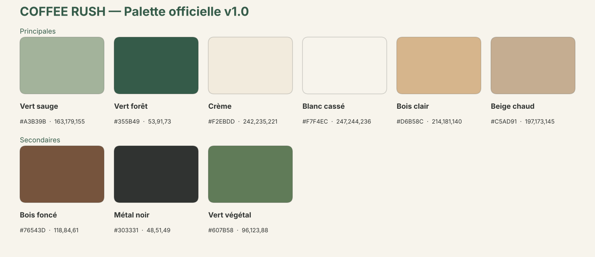

# Coffee Rush — Design System 3D

Référence artistique et technique des assets 3D du jeu Roblox **Coffee Rush**
(coffee shop coopératif 2 à 4 joueurs, inspiré d'Overcooked). Workflow : **Blender → GLB → Roblox Studio**.

> La règle d'or : la cohérence de Coffee Rush passe avant la créativité isolée d'un asset.
> Les règles fondamentales ne changent qu'avec la validation de Hugo.



## Par où commencer

| Je veux… | Lire / utiliser |
|---|---|
| Connaître les règles | [`docs/00_REGLES_MAITRES.md`](docs/00_REGLES_MAITRES.md) (v1.0, référence principale) |
| Les proportions du personnage | [`docs/01_REFERENCE_R15.md`](docs/01_REFERENCE_R15.md) + [planche](references/character/R15/R15_reference_sheet.png) |
| Les hauteurs de meubles, allées, poignées | [`docs/02_ERGONOMIE.md`](docs/02_ERGONOMIE.md) |
| Les limites et réglages Roblox | [`docs/03_ROBLOX_TECHNIQUE.md`](docs/03_ROBLOX_TECHNIQUE.md) |
| Les matériaux et où déposer les textures | [`docs/04_MATERIAUX_TEXTURES.md`](docs/04_MATERIAUX_TEXTURES.md) |
| Modéliser et exporter un asset | [`docs/05_PIPELINE_BLENDER_ROBLOX.md`](docs/05_PIPELINE_BLENDER_ROBLOX.md) |
| Les décisions en attente | [`docs/06_QUESTIONS_OUVERTES.md`](docs/06_QUESTIONS_OUVERTES.md) |

## Arborescence

```
docs/                     règles + guides (FR)
palette/                  palette officielle : .json, .gpl (Blender/GIMP/Krita), .png
standards/ergonomie.json  hauteurs et dimensions de référence (lues par les scripts)
materials/                bibliothèque officielle : materials.json + un dossier par matériau
  WOOD_OAK_LIGHT/           ← déposer ici WOOD_OAK_LIGHT_Color.png, _Roughness.png, _Normal.png…
references/
  character/R15/            mannequin R15 exporté de Studio (OBJ brut + OBJ normalisé), mesures, planche
  moodboard/                images d'ambiance validées
  existing-game/            captures du jeu actuel (ville, magasin, machines)
  roblox/                   liens et synthèse de la doc Roblox
templates/                fiche technique type
tools/blender/            scripts : préparer la scène, créer un asset, contrôler + exporter
assets/<Catégorie>/CR_<Catégorie>_<Nom>/   livrables : GLB, textures/, fiche_technique, preview.png
```

## Workflow en 3 scripts (Blender ≥ 4.2)

1. `tools/blender/cr_01_scene_setup.py` — unités en studs, mannequin R15, repères de hauteur, 10 matériaux officiels (textures branchées automatiquement).
2. `tools/blender/cr_02_new_asset.py` — crée `<Nom>_ROOT` avec catégorie, nom, version, type de pivot.
3. `tools/blender/cr_03_check_and_export.py` — contrôle (noms, échelles, triangles, matériaux, pivot) puis exporte `CR_<Catégorie>_<Nom>_V01.glb` + fiche technique + aperçu.

Import dans Studio : **Scale Unit = Stud**, World Forward = Front, World Up = Top (voir doc 05).
