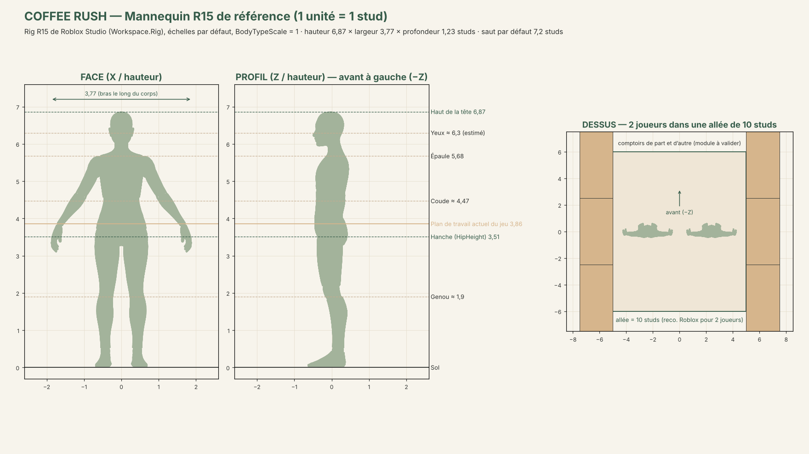

# 01 · Mannequin R15 de référence

## Source

- Exporté par Hugo depuis Roblox Studio (OBJ), place « Copie de Coffee Rush » (placeId 84140333478611), objet `Workspace.Rig`.
- Vérifié dans Studio le 20/11/2026 : `RigType = R15`, `HipHeight = 3,508`, toutes les échelles du Humanoid à 1 sauf `BodyProportionScale = 0`. `BodyTypeScale = 1` signifie des proportions de type Rthro (jambes longues).
- **L'OBJ exporté est déjà à l'échelle 1 unité = 1 stud** : sa boîte englobante (3,774 × 6,865 × 1,231) est identique à celle mesurée dans Studio.

## Fichiers

| Fichier | Usage |
|---|---|
| `RIG_R15_Reference_original.obj` | Export brut de Studio, conservé tel quel. |
| `CR_REF_R15_Mannequin.obj` | Version normalisée : pieds à 0, centré, 15 pièces nommées comme dans Roblox (Head, UpperTorso, LeftHand…). Axes Roblox (Y haut, face avant −Z). |
| `r15_measurements.json` | Toutes les mesures, lues par les scripts Blender. |
| `R15_reference_sheet.png` | Planche face / profil / dessus avec les hauteurs clés. |

Import Blender (fait par `cr_01_scene_setup.py`) : *File > Import > Wavefront (.obj)*, **Forward Axis = Z, Up Axis = Y, Scale = 1** (réglages recommandés par Roblox). Le mannequin arrive pieds à Z = 0, **face avant vers −Y**, comme nos assets.

## Mesures clés (studs, depuis le sol)

| Repère | Hauteur | Origine |
|---|---|---|
| Haut de la tête | **6,87** | mesuré |
| Yeux | ≈ 6,3 | estimé (milieu de la tête) |
| Épaule | 5,68 | haut de UpperArm |
| Coude | ≈ 4,47 | bas de UpperArm |
| Poignet | ≈ 3,85 | haut de Hand |
| Hanche (HipHeight) | **3,51** | Humanoid |
| Bout des doigts, bras le long du corps | 3,09 | bas de Hand |
| Genou | ≈ 1,9 | jonction UpperLeg / LowerLeg |

| Largeur / profondeur | Valeur |
|---|---|
| Bras le long du corps | **3,77** |
| Torse (épaules) | 1,20 |
| Bassin | 1,34 |
| Profondeur totale (pieds compris) | 1,23 |

Mouvement par défaut de la place : saut **7,2 studs** (`CharacterJumpHeight`), marche 16 studs/s.

## Règles

- Ne jamais redimensionner le mannequin (son échelle est verrouillée dans Blender).
- Il représente **un** avatar : les joueurs peuvent avoir des avatars plus petits ou plus grands selon les réglages Avatar du jeu → voir [questions ouvertes](06_QUESTIONS_OUVERTES.md).
