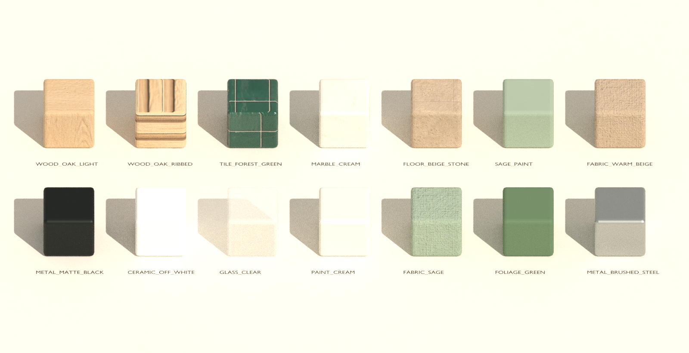

# 04 · Matériaux et textures

La liste des 10 matériaux officiels (§7 des règles), plus 4 matériaux validés le 20/11/2026, est dans [`materials/materials.json`](../materials/materials.json).
Chaque matériau a son dossier `materials/<ID>/` où déposer ses textures.

| ID | Couleur de base | Type | Cartes attendues | État |
|---|---|---|---|---|
| WOOD_OAK_LIGHT | Bois clair #D6B58C | répétable | Color, Roughness, Normal | ✅ v1 (20/11) |
| WOOD_OAK_RIBBED | Bois clair #D6B58C | répétable (lames verticales) | Color, Roughness, Normal | ✅ v1 (20/11) |
| TILE_FOREST_GREEN | Vert forêt #355B49 | répétable | Color, Roughness, Normal | ✅ v1 (20/11) |
| MARBLE_CREAM | Crème #F2EBDD | répétable | Color, Roughness | ✅ v1 (20/11) |
| FLOOR_BEIGE_STONE | Beige chaud #C5AD91 | répétable (carrelage, validé) | Color, Roughness, Normal | ✅ v1 (20/11) |
| SAGE_PAINT | Vert sauge #A3B39B | répétable | Color, Roughness | ✅ v1 (20/11) |
| FABRIC_WARM_BEIGE | Beige chaud #C5AD91 | répétable | Color, Normal | ✅ v1 (20/11) |
| METAL_MATTE_BLACK | Métal noir #303331 | uni | — | couleur unie |
| CERAMIC_OFF_WHITE | Blanc cassé #F7F4EC | uni | — | couleur unie |
| GLASS_CLEAR | Blanc cassé #F7F4EC, transparent | uni | — | couleur unie |
| PAINT_CREAM *(ajout 20/11)* | Crème #F2EBDD | répétable | Color, Roughness | ✅ v1 (20/11) |
| FABRIC_SAGE *(ajout 20/11)* | Vert sauge #A3B39B | répétable (côtes verticales) | Color, Normal | ✅ v1 (20/11) |
| FOLIAGE_GREEN *(ajout 20/11)* | Vert végétal #607B58 | uni | — | couleur unie |
| METAL_BRUSHED_STEEL *(ajout 20/11)* | Inox brossé #B8BBB7 (nouvelle couleur de palette) | uni | — | couleur unie |

Roughness, metallic et taille de répétition dans le JSON = **propositions** à valider.

## Textures v1 (20/11/2026)

Générées par `tools/textures/cr_build_textures.py` à partir des textures de Hugo (`Roblox MAP/assets/textures`) :
- **Color** : la texture de Hugo, recalée sur la couleur de la palette (moyenne en espace Lab) en gardant le motif.
- **Normal** (OpenGL) et **Roughness** : calculées à partir du relief de la texture, sans couture.
- La correspondance matériau → source et les réglages (force du relief, contraste…) sont dans `tools/textures/sources.json` ; les sources sont copiées dans `materials/<ID>/source/`.
- PAINT_CREAM est dérivée de la peinture sauge, FABRIC_SAGE du tissu grège.
- Les packs Poliigon (chêne, zellige, céramique, quartzite, tissu) restent sur le PC de Hugo : non utilisés en v1 et non versionnés (licence).

Pour modifier une texture : remplacer la source ou changer ses réglages, relancer le script, puis `cr_01_scene_setup.py` dans Blender.

## Déposer une texture

1. Nommer le fichier `<ID>_<Carte>.png`, carte ∈ `Color`, `Roughness`, `Normal`, `Metalness`.
   Ex. `materials/WOOD_OAK_LIGHT/WOOD_OAK_LIGHT_Color.png`.
2. PNG, carré, puissance de 2, **1024 px maximum** (limite Roblox). 512 suffit souvent pour un style low-poly.
3. Normal map au format OpenGL (Y+), celui de Blender et de Roblox.
4. Pas de Metalness pour un matériau non métallique.
5. Relancer `cr_01_scene_setup.py` : les textures présentes sont branchées automatiquement sur le matériau Blender.

## Règles (rappel §7 et §8)

- Ne pas inventer de matériau par asset. Un nouveau besoin → proposer un ID, une description, une couleur de la palette, et attendre la validation avant de l'ajouter à `materials.json`.
- Répétables : sans couture, motif discret, échelle cohérente (même nombre de studs par répétition sur tous les assets).
- Assets spécifiques : UV propres, textures orientées, résolution proportionnée à la taille à l'écran.
- Dans Roblox : un **MaterialVariant** (MaterialService, `StudsPerTile`) pour les grandes surfaces répétées, un **SurfaceAppearance** (paquet partagé) pour les MeshParts avec UV dédiées.
