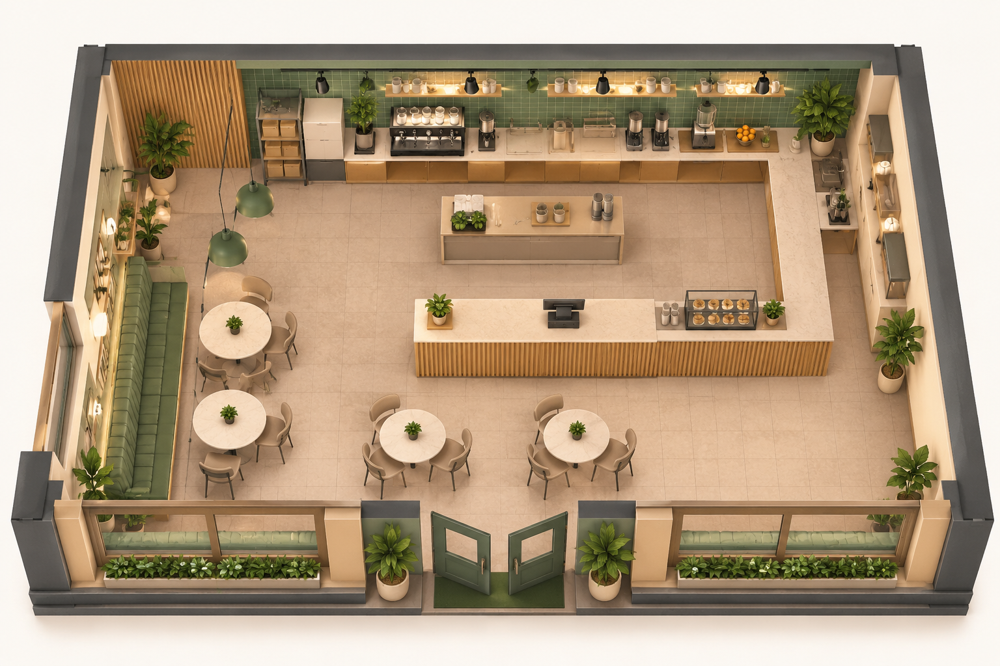
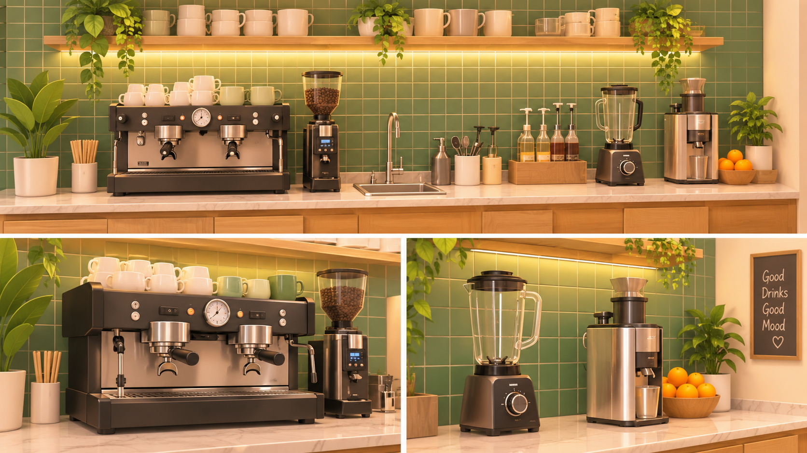
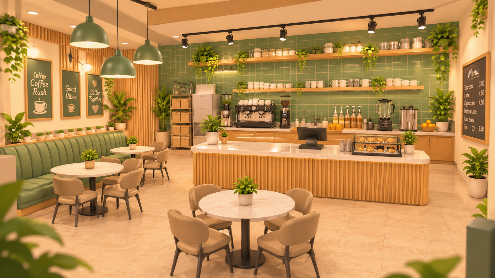
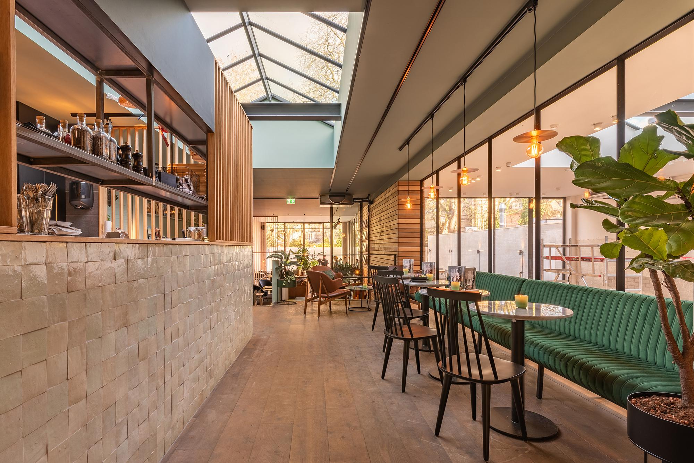

# 07 · Direction artistique du magasin

> Validé le 20/11/2026 : l'ambiance générale du magasin suit les 4 images de [`references/moodboard/`](../references/moodboard/).
> Ce document traduit ces images en règles et en liste d'assets. Les matériaux marqués **NOUVEAU** ont été ajoutés à la bibliothèque le 20/11/2026.

| Plan isométrique | Coin machines | Vue de la salle | Photo réelle |
|---|---|---|---|
|  |  |  |  |

## L'ambiance en une phrase

Un coffee shop cosy et lumineux : murs crème, crédence de carrelage vert forêt, bois clair partout, plans en marbre crème, touches de sauge et beaucoup de plantes, avec du noir mat pour les accents.

## Ce qu'on retient

| Élément | Règle | Matériau |
|---|---|---|
| Murs | Crème unis, sauge en accent | **NOUVEAU** PAINT_CREAM (peinture mate Crème) + SAGE_PAINT |
| Crédence cuisine | Carrelage vert forêt, joints clairs, du plan de travail jusqu'aux étagères | TILE_FOREST_GREEN |
| Façade du comptoir de service | Lames verticales régulières, coins arrondis | WOOD_OAK_RIBBED |
| Meubles bas de cuisine | Portes en bois clair, joints fins | WOOD_OAK_LIGHT |
| Plans de travail, tables | Marbre crème, chants légèrement arrondis | MARBLE_CREAM |
| Cloisons décoratives | Lames de bois verticales espacées | WOOD_OAK_RIBBED |
| Étagères murales | Planche épaisse en bois clair, tasses alignées dessus | WOOD_OAK_LIGHT + CERAMIC_OFF_WHITE |
| Banquette | Sauge, capitonnage en côtes verticales | **NOUVEAU** FABRIC_SAGE |
| Chaises | Assise beige, pieds fins foncés | FABRIC_WARM_BEIGE + METAL_MATTE_BLACK |
| Luminaires | Suspensions sauge en dôme, spots sur rail noir | SAGE_PAINT + METAL_MATTE_BLACK |
| Plantes | Pots blanc cassé, feuillage simple en gros volumes | CERAMIC_OFF_WHITE + **NOUVEAU** FOLIAGE_GREEN |
| Ardoises / menus | Cadre bois clair, fond noir mat | WOOD_OAK_LIGHT + fond METAL_MATTE_BLACK (ardoise noire ; PAINT_FOREST_GREEN non retenu) |
| Porte d'entrée | Double porte vert forêt vitrée | à définir avec le bâtiment |
| Sol | Carrelage beige (texture de Hugo) | FLOOR_BEIGE_STONE |

Formes : arrondis doux (tables rondes, angles de comptoir), répétition de lames verticales, volumes simples et pleins.

## Ce qu'on ne garde pas

- Le photoréalisme et les petits détails : cadrans, logos, écrans, textes minuscules sur les machines (§1, §4). On garde les silhouettes.
- Le vert émeraude saturé et le parquet foncé de la photo réelle (hors palette). De cette photo, on garde les lames de bois, la banquette en côtes, le carrelage zellige du comptoir et les suspensions.
- Les plans de travail encombrés : dans le jeu, un plan ne porte que la machine de sa case et éventuellement une plante. La lisibilité en vue du dessus passe avant (§3).
- Les vitres et transparences en couches (vitrine, bocaux) : une seule surface transparente par objet (performances).

## Machines

Validé le 20/11/2026 : machines **en inox brossé et noir mat**, comme les références.
- Corps et grandes surfaces : **NOUVEAU** METAL_BRUSHED_STEEL (Inox brossé #B8BBB7, ajouté à la palette).
- Poignées, boutons, socles, porte-filtres : METAL_MATTE_BLACK.
- Pas de cadrans ni d'écrans détaillés : de simples formes (disque, rectangle) suffisent.

## Lumière

Validé le 20/11/2026 : **chaude douce**. L'ambiance cosy des références, sans jaunir les couleurs de la palette ni gêner la lisibilité en vue du dessus pendant les rushs. Les réglages Lighting de Studio seront calés sur ce principe quand le magasin sera assemblé.

## Organisation du magasin (d'après le plan isométrique)

- **Cuisine en L** contre le mur du fond et le mur de droite : machines en ligne sur le plan, crédence verte, étagères au-dessus.
- **Îlot central** de préparation entre la cuisine et le comptoir.
- **Comptoir de service** qui sépare cuisine et salle : caisse, vitrine à pâtisseries, plaques de service.
- **Salle** devant : banquette sauge le long du mur gauche, tables rondes, plantes dans les angles.
- **Façade** : double porte centrée, vitrines de chaque côté avec jardinières.

Ce plan sera recalé sur la grille de 5 studs et le plan de travail à 4,0 avant tout modèle du bâtiment.

## Assets à produire

| Catégorie | Assets |
|---|---|
| Furniture | Counter_Kitchen (module 5), Counter_Kitchen_Corner, Counter_Service (lames), Island, Shelf_Floating, Shelving_Storage, Bench_Booth, Table_Round, Chair, Fridge |
| Kitchen | EspressoMachine, Grinder, Blender, Juicer, SyrupRack, Sink, Register, PastryDisplay, Cup, CupStack, FruitBowl |
| Decor | Plant_Pot (S/M/L), Plant_Hanging, Pendant_Lamp, TrackLight_Rail, Chalkboard_Menu, Chalkboard_Wall, WallSlats, Planter_Window |
| Building | Wall_Backsplash_Tile, Wall_Plain, Window_Front, Door_Double_Front |

Ordre conseillé : d'abord **Counter_Kitchen**, car il fixe la hauteur, la profondeur, le pivot et les matériaux de toute la famille, puis les machines posées dessus.
